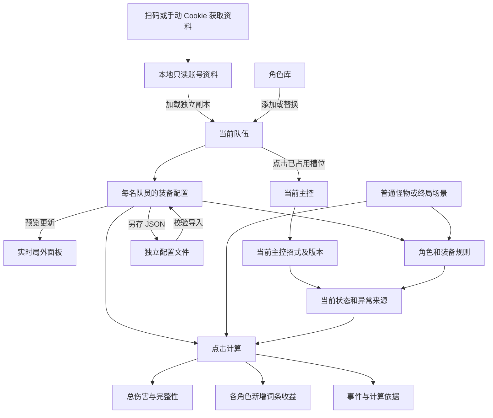

# 绝区零计算器前端重设计参考

基准日期：2026 年 10 月 14 日。范围为当前前端工作台，已合并上游 v2.1（`3b650d7`）的计算与目标语义更新，布局参考用户提供的 `zzz-calculator-prototype.html`。原型中的示例人物、数值、演示登录与临时文件格式不进入正式实现。

产品的主流程是：取得角色配置，组成队伍，编辑装备，选择目标和场地，设置当前战斗状态，计算招式伤害，再查看新增副词条收益与计算依据。重设计可以重新组织页面和组件外观，但需要保留角色资料、编辑副本、场景和计算结果之间的区别。

## 页面结构与集合关系

当前为单页工作台，没有应用内多页面路由。桌面左栏管理队伍与实时局外面板，中栏通过三个标签页配置装备、目标、状态，右栏显示本次结算与分析。手机使用底部五项导航，按当前导航显示队伍、装备、目标、状态或结算。标签切换只隐藏面板，保留输入和终局控件状态。

```text
计算器工作台
├─ 页头：项目 Logo、分区导航、版本标记、使用说明
├─ 左栏 / 队伍与面板
│  ├─ 三个队伍槽位：设主控、编辑、替换、前移、后移、移除
│  ├─ 米游社加载入口 → 登录及本地资料弹窗
│  └─ 每名队员局外面板折叠卡 → 属性来源抽屉
├─ 中栏 / 构筑工作台
│  ├─ 角色装备标签页
│  │  ├─ 编辑角色切换（独立于主控）
│  │  ├─ 身份、导入、另存、装备折叠
│  │  ├─ 有效词条总数、各项次数、小词条、自定义方案
│  │  ├─ 角色等级、核心、影画，以及技能等级折叠区
│  │  ├─ 音擎、固定等级、精炼
│  │  └─ 六张盘摘要卡 → 对应盘编辑抽屉；套装统计及清除全部
│  ├─ 敌人与场地标签页
│  │  ├─ 普通怪物 / 式舆 / 危局模式卡
│  │  ├─ 真实目录、变体，或期数、防线/试炼、房间、目标、Buff
│  │  └─ 场地状态、源文、场景文件，以及目标属性覆写
│  └─ 场景与规则标签页
│     ├─ 角色专属配置、独立状态、异常来源
│     ├─ 次数、数值、持续时间
│     └─ 技能与装备规则折叠区，以及触发角色选择
├─ 右栏 / 本次结算与分析
│  ├─ 主控招式及倍率版本、计算按钮、快捷键
│  ├─ 本次时间、目标、完整性与过期提示
│  ├─ 期望主卡，以及不暴击与满暴击次卡
│  ├─ 各队员收益前三项、模式切换 → 全部收益弹窗
│  ├─ 伤害事件摘要 → 对应事件因子与规则追踪抽屉
│  └─ 构筑来源、局内来源、结算快照、诊断抽屉
└─ 页面级接口错误、使用说明、手机底部导航
```

| 父集合 | 子对象与数量 | 必须保留的关系 |
| --- | --- | --- |
| 页面 | 1 个当前队伍，固定展示 3 个槽位 | 队伍可为空；最多 3 个不同角色；主控必须是其中一人 |
| 队伍成员 | 1 份当前装备配置，1 张实时面板 | 用角色 ID 对应；切换主控不会交换或复制装备 |
| 当前装备配置 | 0 或 1 把音擎，6 个驱动盘槽位 | 没有装备的槽位也保留可操作入口 |
| 已装备驱动盘 | 1 个套装、1 个主词条、0–4 种副词条 | 已选择的主词条与副词条不能是同一词条类型；固定攻击和攻击力%为不同类型；未完成编辑时主词条可为空 |
| 有效词条方案 | 0–6 种被选中的属性 | 统计来自当前盘的副词条次数，不包含主词条、套装和音擎属性 |
| 本地米游社资料 | 最多保留 5 个账号，每个账号有角色列表 | 以 UID 分账号保存；同账号再次获取整体覆盖旧资料 |
| 普通目标 | 1 个目录条目、1 个变体、1 组当前属性 | 展示名相同的怪物通过目录 ID 与变体区分 |
| 终局场景 | 模式 → 期数 → 防线或试炼 → 房间 → 攻击目标 | 各级选项来自上一层；房间和目标数量不固定 |
| 终局房间 | 必选场地效果，以及 0 或 1 个当前可选增益 | 首期产品支持比较零个或一个可选增益，不把此限制当作所有玩法的通用规则 |
| 一次计算 | 1 个当前主控招式及版本 → 多个伤害事件 | 派生事件可能来自支援、异常、紊乱或异放，不能只保留一个伤害数字 |
| 伤害事件 | 后端指定的暴击展示模式及各自结果 | 通常为不暴击、期望、满暴击；不适用的模式按返回数据省略 |
| 词条收益 | 每个上场角色 1 组比较结果，每组通常 10 行 | 命破角色不提供穿透值建议，因此通常为 9 行；比较的是整次计算的总伤害 |

## 视觉层级与通用形态

以下为现有形态，用于描述组件边界。它们可以改成新的视觉样式，分组、字段归属、状态含义仍需保留。

| 元素类型 | 当前形状与内容组织 | 对应使用位置 |
| --- | --- | --- |
| 页面分区 | 大型圆角矩形，标题、说明、正文；主分区圆角约 12px | 队伍、装备、场景、计算结果 |
| 对象卡片 | 较小圆角矩形，通常 7–9px；顶部身份、内部字段、底部状态 | 角色装备、实时面板、驱动盘、事件 |
| 身份图像 | 角色头像为圆角方形；槽位立绘为裁切矩形 | 角色卡片、装备标题、实时面板 |
| 主按钮 | 橙色实心圆角矩形，约 40px 高 | 计算、获取资料、安全验证 |
| 次按钮与工具按钮 | 描边或淡紫底圆角矩形，约 34–35px 高 | 导入、另存、折叠、清除、替换 |
| 图标按钮 | 小方形圆角按钮，删除使用叉号；有可访问名称 | 删除副词条、关闭角色库 |
| 状态标签 | 小型圆角矩形；短文字和状态色 | 主控、稀有度、已同步、完整、空槽 |
| 属性数字 | 标签在上、总值突出、必要时下方有白值与附加值 | 局外面板、伤害总值 |
| 数字输入 | 标签和单位在上，输入框居中，说明或错误在下 | 等级、精炼、层数、敌人属性 |
| 下拉选择 | 圆角矩形，显示当前项和展开提示 | 角色筛选、技能、主副词条、招式、期数 |
| 布尔状态 | 带说明的一行或卡片，右侧复选框 | 角色状态、失衡、场地触发、规则开关 |
| 滑块 | 标签、当前值标签、横向滑轨、帮助文字 | 核心、影画及后端指定的整数配置 |
| 折叠区域 | 可点击标题，原位置显示或隐藏正文 | 局外面板、技能、有效方案、规则、收益角色 |
| 表格 | 属性行与数字列，细分隔线；必要时局部横向滚动 | 新增词条收益 |
| 覆盖式弹窗 | 深色遮罩，中间有限高度卡片，内部滚动；Escape 关闭、焦点约束和恢复 | 角色库、米游社、全部收益、说明 |
| 右侧抽屉 | 桌面右侧定宽，手机全屏；固定标题和可选底栏，中部滚动 | 单盘编辑、属性来源、事件与本次计算明细 |
| 下拉浮层 | 定位在选择器下方，有最大高度、分组和内部滚动 | 音擎选择 |
| 二维码 | 白底正方形图片，当前最大宽度约 240px | 米游社扫码登录 |

现有色彩语义：炭黑背景 `#0c0d0f`，正文 `#eeeff2`，次要文字 `#a1a5af`，帮助文字 `#8a909c`；橙色 `#f6bd67` 表示主操作和期望伤害重点，紫色 `#ac99f2` 表示可编辑选项与选择，绿色 `#8ed7ac` 表示附加值、完整和成功，黄色 `#e5bd79` 表示未完成或待确认，红色 `#ff9eae` 表示错误或删除操作。状态必须同时有文字，不能只靠颜色区别。

分区标题约 16px，角色名称约 20px，重要属性数字约 26–30px；普通控件文字约 11–13px。数值使用等宽数字排版，小数和百分比按展示格式处理，计算精度不因显示舍入而改变。

## 页头与导航元素

| 元素 | 内容 | 形态 | 交互与去向 |
| --- | --- | --- | --- |
| Logo | 用户提供的绝区零计算器图标 | 桌面横版约 226 × 60px；手机约 188 × 47px | 返回 `#configuration-section` |
| 工作台引导 | 每一份伤害，都有迹可循；配置、收益、来源说明 | 标题与短介绍 | 空状态也显示 |
| 版本说明 | 从前端包读取版本号，当前 v2.1.0 | 短状态文字与圆点 | 小屏隐藏 |
| 队伍与面板 | 分区名称 | 导航链接 | 跳至 `#team-section` |
| 构筑工作台 | 分区名称 | 导航链接 | 选择装备标签，跳至 `#configuration-section` |
| 伤害与收益 | 分区名称与箭头提示 | 橙色强调链接 | 跳至 `#calculation-section` |

当前导航是同页锚点，跳转不清空输入、不切主控、不重新计算。中栏标签页可键盘左右键、Home、End 切换。手机底部导航更新当前显示区，不清空队伍或输入。

## 米游社资料与导入元素

米游社入口位于队伍卡片底部，打开独立弹窗；空装备页也提供入口。其内部账号资料是只读来源，加载后交给页面的是独立编辑副本。

| 元素 | 内容和状态 | 形态 | 操作结果 |
| --- | --- | --- | --- |
| 米游社入口 | 从米游社加载我的角色 | 折叠标题 | 原位置展开登录和账号资料 |
| 登录方式 | 扫码登录、手动 Cookie | 两个互斥页签按钮 | 切换登录方式，清理本次认证、验证和临时 Cookie 状态 |
| 扫码图片与说明 | 二维码、待扫描、手机确认、成功、有效至时间 | 方形图片与状态文字 | 生成后自动查询扫码状态；手机确认后取得临时登录会话 |
| 扫码操作 | 生成、重新生成、切换扫码账号、取消、退出登录 | 操作按钮组 | 根据阶段改变按钮名称；过期后允许重新生成 |
| 扫码账号选择 | 昵称与国服 UID | 下拉框 | 只有自动读取到多个游戏账号时出现 |
| 游戏 UID | 国服游戏 UID | 数字键盘提示的文本框 | 始终有手动填写入口；提交前校验格式 |
| 手动 Cookie | 登录 Cookie | 密码样式输入框 | 只在手动方式显示；提交后清空输入，不保存认证凭据 |
| 获取并保存 | 获取中、取消获取、成功或错误 | 主按钮、取消按钮、状态文字 | 成功更新本地只读资料，供用户选择加载；不会自动把全部角色加入队伍 |
| 安全验证 | 继续获取、验证中、失败、过期、取消 | 独立提示卡和第三方验证弹窗 | 挑战完成后继续本次获取；无需重新填写仍有效的认证资料 |
| 已保存账号 | UID、角色数量 | 下拉框 | 切换离线角色列表，并同步 UID 输入 |
| 获取时间 | 账号资料的读取时间 | 次级说明文字 | 表明资料是哪次获取的快照 |
| 本地角色条目 | 名称、等级、影画、导入问题、是否支持 | 列表卡片 | 按数值角色 ID 降序排列 |
| 加载到当前槽位 | 当前角色是否具备可用配置 | 次按钮 | 更新该角色的编辑副本；角色不在队伍时替换主控所在槽位，队伍为空时加入第一位；角色已在队伍时不重复加入，并将其设为主控 |
| 清除本地资料 | 清除结果提示 | 次按钮 | 清除账号快照列表；已加载的队伍和编辑副本继续存在 |

扫码阶段为：未开始 → 正在生成 → 待扫描 → 已扫描待确认 → 已确认；取消、过期和错误均有返回生成入口。安全验证是获取角色时的条件分支，不是每次登录固定需要的步骤。

## 队伍槽位与角色库

| 元素 | 内容 | 形态与状态 | 交互 |
| --- | --- | --- | --- |
| 队伍标题 | 队伍与当前角色、点击及拖动说明、人数 `N/3` | 标题与人数标签 | 说明当前集合大小 |
| 空槽位 | 加号、添加角色、槽位序号 | 竖向虚线圆角卡片 | 点击打开该槽位的角色库；按顺序添加，后面的空槽在前一位未填时禁用 |
| 已占用槽位 | 立绘、名称、稀有度、职业、属性 | 竖向角色卡 | 点击卡片设为主控；当前主控有文字徽标和描边 |
| 拖动提示 | 拖动交换 | 覆盖在图片下方的小标签 | 已占用槽位之间交换位置，主控身份仍跟随角色；手机从图片区域起拖 |
| 编辑 | 当前角色的装备副本 | 次按钮 | 打开装备标签并切换编辑对象，不改变主控和招式 |
| 前移 / 后移 | 队伍顺序 | 箭头按钮 | 键盘可交换相邻槽位；首尾边界禁用 |
| 替换 | 替换当前槽位角色 | 次按钮 | 打开角色库；替换主控槽位时，新角色成为主控 |
| 移除 | 从当前队伍移除角色 | 删除色次按钮 | 后续槽位前移；移除主控时优先选择原位置附近剩余角色，空队伍则清空主控 |
| 主控摘要 | 当前名称、角色 ID、支援人数 | 一行或换行文字组 | 与当前主控卡片同步 |
| 角色库容器 | 标题、目标槽位说明、关闭按钮 | 覆盖式弹窗 | 遮罩点击或关闭按钮退出，取消不改变队伍 |
| 角色库筛选 | 搜索、职业、属性、阵营 | 文本框与三个下拉框 | 联合筛选；每次打开角色库重置筛选条件 |
| 角色库选项 | 小立绘、名称、职业、属性、阵营、稀有度 | 可点击列表卡片 | 按角色 ID 数值降序；已在队伍的角色禁用并显示队伍中 |
| 筛选空结果 | 没有符合条件的角色 | 提示区 | 可调整筛选条件 |

搜索匹配名称、角色 ID 及源职业、属性、阵营字符串。职业和属性的展示名称为中文，源字段可能是 `attack`、`electric` 等代码；重新设计搜索时需保留显示词与源字段的映射。

添加新队员不会自动切换已有主控。移除队员不等于删除本地米游社资料；当前页面中以角色 ID 保存的编辑内容也不是账号快照的一部分。

## 实时局外面板

队伍每名角色一张折叠面板卡，主控默认展开；折叠标题保留名称、身份和攻击力。它由装备构筑预览生成，与当前招式的战斗结算面板不同，不提供直接修改总属性的输入框。

| 元素 | 内容 | 形态和显示条件 |
| --- | --- | --- |
| 分区状态 | 待配置、更新中、已同步 | 状态标签；反映预览请求进度 |
| 角色身份 | 头像、名称、主控或支援、当前有效伤害属性 | 卡片标题 |
| 构筑状态 | 等待解析、已解析、配置未完成 | 与已同步分开表示；请求完成仍可能有不完整配置 |
| 攻击力 | 当前局外总值；白值与附加值 | 占满一行的主要数字卡，白值包含音擎基础攻击力 |
| 暴击率和暴击伤害 | 百分比 | 两个数字卡 |
| 属性增伤 | 对应当前有效伤害属性的增伤百分比 | 主要数字区下方整行 |
| 其他属性 | 生命值、防御力、冲击力、异常精通、异常掌控、穿透值、穿透率、能量自动回复 | 次级数字网格 |
| 贯穿力 | 当前局外攻击、生命得到的贯穿力 | 仅命破角色显示 |
| 属性拆分 | 生命、攻击、防御、异常掌控、能量自动回复的白值与附加值 | 总值下方小字；附加值绿色，零值仍显示，缺失使用 `—` |
| 来源明细 | 基础、音擎、驱动盘、套装贡献；属性、层级、数值 | “查看属性来源”打开对应角色抽屉；不是直接编辑入口 |

缺失值与零值必须区分。面板暴击率可以超过 100%，展示保留原始值；概率上限在伤害结算时处理，属性溢出仍可能用于角色转化。面板更新不能被当作已经重新计算伤害；局外面板、局内加成来源和结算快照也不能合并成一个含义不清的属性卡。

## 角色装备配置

### 身份和折叠

中栏一次显示一名编辑角色的配置；角色切换按钮与左栏“编辑”执行同一操作。全部队员的配置仍保存在页面内存，切换不会复制装备或切换主控。

| 元素 | 内容 | 形态 | 行为 |
| --- | --- | --- | --- |
| 角色标题 | 头像、名称、主控或支援、职业和属性 | 卡片头部 | 对应当前队伍成员 |
| 展开或折叠 | 展开装备配置、折叠装备配置 | 工具按钮 | 只改变详细控件的可见性，不清空任何数据 |
| 导入配置 | 当前角色配置 JSON | 按钮和文件选择器 | 校验角色、字段和装备；成功更新编辑副本，不写回米游社资料 |
| 另存配置 | 当前角色等级、核心、影画、技能、音擎、盘和有效方案 | 工具按钮 | 下载带时间标记的 `-copy-` JSON 文件 |
| 操作反馈 | 导入失败、导入成功、另存成功 | 文字反馈条 | 反馈归属于这名角色 |
| 折叠摘要 | 角色等级、影画层数、音擎名称、精炼 | 只读字段组 | 折叠时仍显示 |
| 有效词条 | 总数量、各属性数量、小词条数量、来源 | 卡片顶部常显 | 折叠时保留统计；方案设置入口在详细状态下显示 |

### 有效词条统计与方案

可选有效属性为攻击力百分比、生命值百分比、防御力百分比、暴击率、暴击伤害、异常精通。每个属性以标签和次数组成一个统计块，另有总数量。

例如 `攻击力% 10 +3`：10 为百分比副词条次数，`+3` 是固定攻击力副词条次数，小字号展示且不计入总有效词条。固定生命、防御与其百分比属性使用相同配对方式。非命破角色额外显示穿透值小词条数量，穿透值不计入总数，但进入伤害和收益计算。

| 元素 | 内容与操作 |
| --- | --- |
| 总有效词条条数 | 依据当前编辑的盘重新统计，不能直接拿米游社历史总数替代 |
| 统计来源 | 自定义方案、米游社默认方案、职业预设；旁边可展示米游社获取时的历史条数 |
| 配置有效词条 | 折叠区域内的多选复选框，允许全不选 |
| 恢复默认方案 | 清除该角色的自定义覆盖，回到米游社方案或职业预设 |
| 默认优先级 | 当前自定义方案 → 已加载的米游社方案 → 职业预设 |
| 职业预设 | 异常为攻击力%与异常精通；命破为生命值%、攻击力%、暴击率、暴击伤害；其他为攻击力%、暴击率、暴击伤害 |

有效方案决定统计和收益行的分类标签；没有选为有效的副词条仍可能影响计算，不能因此从真实装备数值中删除。

### 角色养成与音擎

| 元素 | 内容和范围 | 形态与条件 |
| --- | --- | --- |
| 角色等级 | 界面范围 1–60 | 数字输入；实际支持等级由当前角色数据决定，不能在源不支持时推算 |
| 核心与影画 | 后端定义的当前值与范围 | 通常为整数滑块及当前值标签；只读定义不可编辑 |
| 技能等级 | 普攻、闪避、特殊技、连携、支援、终结等技能组 | 按后端选项渲染的下拉框；保留基础等级与影画加级的含义 |
| 其他角色配置 | 潜能或角色特有布尔、整数、选项 | 由定义动态出现，不能假设所有角色拥有同样字段 |
| 音擎选择标题 | 当前音擎名称或无音擎 | 可展开选择器 |
| 音擎菜单 | 无音擎、同职业音擎、其他职业分组 | 下拉浮层；各组按专武优先、稀有度优先、ID 降序排列 |
| 音擎等级 | 当前模型为 60 | 只读数字框 |
| 精炼 | 1–5 阶 | 数字输入 |
| 职业不匹配说明 | 当前提示为仅基础攻击力和主词条生效 | 提示文字，不能把选择器限制成只能装备本职业；基础值与特效实际适用性仍由计算定义决定 |

选择音擎后关闭菜单并返回选择器焦点。菜单支持点击外部关闭和 Escape 关闭。角色库的关闭方式与这个浮层不同，不能把两者混为同一种跳转。

### 驱动盘卡片

工作台只显示摘要卡：槽位、完整性、套装图标与名称、主词条值、各副词条总值和次数、总次数。点击卡片打开该盘的编辑抽屉；以下编辑控件位于抽屉内。修改立即生效，“完成”关闭抽屉，不写回本地资料。

每个角色固定六个槽位，当前装备模型为 S 级满级驱动盘。不能因为槽位没有装备就把该槽位的入口移除。

| 元素 | 内容 | 交互或状态 |
| --- | --- | --- |
| 分区标题与操作 | 驱动盘、6 个槽位、清除全部驱动盘 | 清除该角色的全部盘；没有盘时清除按钮禁用 |
| 卡片身份 | 槽位编号、套装图标、套装名 | 空槽显示编号占位和未装备驱动盘 |
| 完整状态 | 完整、未完成、空槽 | 三种状态分开显示 |
| 删除驱动盘 | 删除整张当前盘 | 清空该槽位；不等同于删除一个副词条 |
| 套装选择 | 套装目录或空槽 | 选空槽相当于清空盘；套装效果原文在卡片提示中可查 |
| 主词条选择 | 可用属性与满级值 | 固定主词条槽位只读；灵活槽位允许未选择 |
| 主词条预览 | 名称和当前加成值 | 只读数字行 |
| 副词条列表 | 当前副词条种数 `N/4` | 每行是一种属性，不是每一次强化 |
| 副词条属性 | 当前属性和合法备选项 | 下拉框，排除重复属性及主词条冲突 |
| 副词条删除 | 删除这一种副词条及其次数 | 叉号按钮，只影响当前盘的这一行 |
| 次数调整 | 减号、次数、加号 | 单行 1–6 次，边界按钮禁用 |
| 单行数值 | 单次数值 × 次数 = 总计 | 保留强化次数与属性总值的对应关系 |
| 添加副词条 | 属性选择、添加按钮 | 少于 4 行时出现；添加后默认 1 次 |
| 总词条次数 | 所有副词条次数之和 | 主词条已定、4 种副词条且总次数为 8 或 9 才显示完整 |
| 局部诊断 | 当前槽位配置问题 | 显示在对应盘卡内 |
| 套装统计 | 套装名 × 当前件数 | 位于六盘集合下方，并影响 2 件套、4 件套规则 |

主词条槽位关系：

| 槽位 | 可选主词条 |
| --- | --- |
| 1 | 固定生命值 |
| 2 | 固定攻击力 |
| 3 | 固定防御力 |
| 4 | 暴击率、暴击伤害、攻击力%、生命值%、防御力%、异常精通 |
| 5 | 攻击力%、生命值%、防御力%、物理／火／冰／电／以太／风属性增伤、穿透率 |
| 6 | 攻击力%、生命值%、防御力%、冲击力%、异常掌控%、能量自动回复% |

删除、清除、替换套装、改主副词条都需要刷新实时面板、套装件数和相关规则。改变主词条时只移除相同属性的副词条冲突，其余合法行继续保留。

## 敌人与终局场地

### 普通怪物与共用属性

| 元素 | 内容 | 形态与行为 |
| --- | --- | --- |
| 计算模式 | 普通怪物、式舆防卫战、危局强袭战 | 单选下拉，决定下面显示哪组目标选择器 |
| 搜索怪物 | 名称、阵营、目录 ID | 文本框，只筛选目录选项 |
| 目标怪物 | 名称与目录 ID | 下拉，只提供具有可用变体的怪物 |
| 怪物变体 | 变体 ID、默认标记 | 下拉，同名目录的具体属性版本 |
| 资料说明 | 阵营、等级分类、正式数据版本、查看怪物资料 | 文字和外部链接 |
| 防御自动更新 | 防御随等级更新 | 复选框；手动编辑防御后停止自动覆盖 |
| 恢复默认属性 | 还原当前变体或当前场地目标默认值 | 次按钮，清理手动覆写状态 |
| 等级 | 1–80 | 整数输入；普通模式自动防御开启时联动防御 |
| 防御 | 实际防御数值 | 数字输入，保留自动来源或手动来源说明 |
| 属性抗性 | 物理、火、冰、电、以太、风、流明 | 百分比输入；数据缺失不能标成源提供的零抗性 |
| 失衡易伤加成 | 额外易伤，50% 对应总倍率 1.5× | 百分比输入，传输值为 `0.5`；目录中的总失衡倍率减去基础 1 后填入 |
| 减易伤 | 伤害减免字段 | 百分比输入 |
| 当前处于失衡 | 当前目标状态 | 复选框，与失衡倍率独立 |
| 抗性映射说明 | 烈霜沿用冰、玄墨沿用以太、凛刃沿用物理 | 帮助文字 |
| 流明确认 | 源缺失流明抗性时提供输入或确认入口 | 条件性提示和按钮；涉及流明伤害的计算前需明确提供 |

怪物搜索和选项切换都是本页操作；查看怪物资料会打开外部 Nanoka 页面。切换怪物或变体恢复对应默认属性，不沿用上一只怪物的手动防御与抗性。

### 式舆与危局选择链

| 元素 | 内容 | 显示条件与联动 |
| --- | --- | --- |
| 正式期数 | 日期或名称、期数 ID、进行中／历史／常驻／即将开放 | 进入终局模式后显示；默认优先当前期，再历史期 |
| 日期与来源 | 国服开放区间、正式版本、查看本期资料 | 源提供的时间和外部链接 |
| 防线或难度与试炼 | 当前期数的阶段列表 | 式舆显示防线，危局显示难度与试炼 |
| 房间 | 房间名与顺序 | 随阶段变化，不固定为上下半 |
| 本次攻击目标 | 名称与内部变体 ID | 随房间变化，本次选择一个目标进行计算 |
| 波次说明 | 房间波次数 | 当前仅为说明，不是逐波选择器；源只给合并目标列表 |
| 生命档位 | 当前档位与可用范围 | 阶段提供档位时出现；影响最大生命元数据，不改变战斗等级 |
| 可选场地增益 | 不应用可选增益，或一个 Buff 名称 | 房间存在可选增益时显示 |
| 目标摘要 | 最大生命、等级、防御 | 只读说明 |
| 场地触发状态 | 命名状态与作用角色 | 最大值为 1 时为复选框，否则为层数数字输入；默认未触发或 0 层 |
| 场地原文与范围 | Buff 标题、原文、未决条款和计算边界 | 折叠区域 |
| 场地规则开关 | 命名规则的启用或关闭 | 折叠区域内复选框，用于对照计算 |
| 场景导入与导出 | `zzz-scene-config-v1` 文件 | 按钮与文件选择；包含目标、Buff、状态、覆写和数据摘要 |
| 场景加载与错误 | 读取中、失败、摘要不一致 | 保留独立反馈；未加载到有效场景时不允许提交计算 |

切换期数或阶段会重新建立场景默认选择。切换房间清空触发状态、关闭规则列表、可选增益和旧目标覆写；切换目标清空目标相关状态与覆写；切换可选增益清空触发状态和关闭规则列表。队伍成员集合变化会清空场地个人状态和关闭规则列表，防止旧成员状态继续作用。

场景文件不包含队伍装备，导入后沿用当前队伍。导入前需切到文件对应模式，并校验期数及快照摘要，避免把某一版本的场景套在另一份数据上。

## 场景状态与规则控件

这部分控件是数据驱动集合，来自当前队伍成员、音擎、驱动盘套装与当前场景定义。重设计不能只为某个示例角色画固定数量的开关。

| 集合 | 元素内容 | 形态 | 关联对象 |
| --- | --- | --- | --- |
| 角色特殊配置 | 名称、值、范围、帮助、可编辑标志 | 布尔、数字、下拉或滑块 | 某个角色的编译配置；核心和技能已归入装备区，其余字段放在这里 |
| 独立角色状态 | 状态名称、条件说明、当前是否成立 | 说明行与复选框 | 当前队伍中的角色或装备规则；只展示可编辑且非倍率版本的独立条件 |
| 次数与数值 | 参数名、范围、当前值、原文依据 | 数字输入 | 当前招式或角色规则；某些紊乱剩余时间随效果启用情况调整范围 |
| 规则列表 | 规则名称、来源、适用性、可用性、启用情况 | 带说明的行、复选框、可选层数框 | 角色、音擎或盘效果；不可切换项保持只读或禁用 |
| 触发事实 | 触发名称、允许的入场角色、已指定或未指定 | 下拉与状态说明 | 某条规则的触发参与者；留空可能使该效果受阻 |

选择异常来源是计算当前事件的输入，不切换主控，也不把来源角色自动加入队伍。

| 条件性来源集合 | 控件内容 | 出现关系 |
| --- | --- | --- |
| 蕾米埃尔虚曜来源 | 最多三个来源槽；空槽、普通来源、按影画开放的特殊来源 | 蕾米埃尔为主控；普通来源来自当前队友面板，特殊来源使用自身快照 |
| 极性紊乱来源 | 队员与属性组成的异常记录选项 | 月城柳相应招式，或南宫羽相关触发成立，并且存在可用异常来源 |
| 柏妮思灼热抛接异放 | 选择异常来源，默认自身灼烧 | 柏妮思为主控且选定对应招式 |
| 格莉丝脉冲手雷异放 | 选择异常来源，默认自身感电 | 对应潜能招式和准备状态成立 |
| 爱芮、南宫羽、普罗米娅异放 | 原异常来源选项，默认对应角色自身属性记录 | 由主控、招式、状态、影画及目标条件共同控制 |

来源列表随队伍、装备面板和角色定义变化；原来源失效时要回到合法默认选择，不能继续显示已经离队的旧来源。

## 招式结算与新增词条收益

### 提交与总结果

| 元素 | 内容 | 状态与交互 |
| --- | --- | --- |
| 招式下拉 | 当前主控角色的招式和互斥倍率版本 | 更换招式或版本刷新相关状态、参数与规则；没有队员时禁用 |
| 计算按钮 | 计算、计算中 | 队伍为空、正在计算、定义更新中、没有合法招式、倍率冲突或终局场景未就绪时禁用 |
| 计算前提示 | 需要角色、选择招式、倍率版本冲突或缺失场景 | 与对应入口保持相邻 |
| 未计算空状态 | 先配置队伍角色，或选择招式后开始结算 | 大面积空状态卡，说明下一步 |
| 场景来源摘要 | 普通目标以配置为准；终局结果附模式、期数、房间、目标 | 说明本次结果对应的场景 |
| 结果过期提示 | 配置已变化，请重新计算 | 已有结果与当前输入不同的状态；不可把旧结果显示成最新值 |
| 总伤害 | 不暴击、期望伤害、满暴击 | 按适用模式展示数字卡；期望伤害用橙色突出 |
| 完整性 | 完整结算、部分结算 | 每个模式分别标注，不能把部分已知伤害当作完整结果 |

正式伤害和收益在用户点击计算后更新。编辑装备会自动刷新局外面板，但不会自动产生新一轮伤害结果。部分编辑会直接清空旧结果，其他编辑通过结果过期提示保留旧结果供对照。

### 收益表格

每名上场角色有一个可折叠的收益区域，主控默认展开。可切换不暴击、期望、满暴击模式；摘要按当前模式的已知比例排序，显示前三项。“全部 N 项”打开完整表格；点击摘要词条也打开完整表并展开对应词条。没有完整比例的行保留为未知，排序位于已知行之后，不伪造零值。每行表示只给该角色增加一种、一条 S 级副词条，其他装备、场地、目标、招式与状态保持本次计算设置。

| 表格列 | 内容 |
| --- | --- |
| 新增词条 | 属性名、单条增加值；可展开查看三种暴击模式的前后对比 |
| 分类 | 有效词条、小词条、未选词条 |
| 增加后伤害 | 重新经过计算内核后得到的整次计算总伤害 |
| 伤害增加 | 对比总伤害与原总伤害之差 |
| 增益 | 相对基准的增益百分比 |

当前单条值为：固定攻击 19、固定防御 15、固定生命 112、穿透值 9、异常精通 9、暴击率 2.4%、暴击伤害 4.8%、攻击力% 3%、生命值% 3%、防御力% 4.8%。数值定义由计算端提供，前端不另设一套。

基准为零时百分比显示 `—`，绝对差值仍可显示。基准或对比未完整结算时，不能显示为零收益。已满级或副词条次数已满的真实盘仍可做理论新增词条比较，这个分析不会向某张盘里实际插入新词条。

## 事件详情与诊断元素

| 元素 | 内容 | 组织和显示条件 |
| --- | --- | --- |
| 伤害事件卡 | 招式或派生事件名称、语义 ID、属性、重复次数 | 一次计算可有多张；不能按数组位置把不同模式的事件混在一起 |
| 模式结果 | 各适用暴击模式的已知伤害、状态 | 与总伤害卡不同，这是当前事件的结果 |
| 每跳伤害 | 周期异常的单跳值 | 周期异常重复次数大于一时展示，同时保留合计 |
| 异放倍率说明 | 原异常每跳、异放倍率、结算倍率 | 具有对应计算节点时出现 |
| 计算节点 | 节点名称、数值、读取规则 | 在事件抽屉中展示，当前主要显示期望模式的 breakdown |
| 异常强度来源 | 原异常记录、因子、贡献角色及其读取值 | 异常或紊乱事件的详情；缺少因子时说明记录只提供已有强度 |
| 规则与效果追踪 | 来源名、规则状态、条件、子效果、修正路径、诊断 | 位于事件详情内部；区分已匹配、未匹配、受阻和用户关闭 |
| 保证暴击来源 | 对应规则、效果名或 ID | 存在保证暴击效果时展示 |
| 薇薇安来源面板结果 | 各来源角色的异放合计与事件 | 单独结果集合，不并入上方当前招式总计；避免重复展示自身当前面板结果 |
| 装备构筑来源 | 按角色分组的基础和装备贡献 | 结果区入口打开按角色分组的抽屉，计算有来源时出现 |
| 局内面板来源 | 接收角色、效果来源、属性路径、加成数值 | 结果区抽屉，与局外来源明细分开 |
| 结算面板快照 | 角色、攻击力、暴击率、属性增伤 | 结果区抽屉，表示结算采用的面板 |
| 计算诊断 | 阻塞项与普通说明 | 结果附近显示；标为详情说明的非阻塞项放入计算说明折叠区 |
| 页面级接口错误 | 请求失败的错误消息 | 页面底部独立区域，不等同于某一伤害事件不完整 |

详情属于解释和排查入口。它们可以收进侧栏、抽屉或单独详情页，但必须能回到对应角色、事件和这次计算，不能让用户误认为详情内的旧数值是当前输入。

## 跳转与联动流程



图中的箭头表示数据或操作联动，不代表全部需要设计成页面跳转。标签页和手机导航改变当前显示区，弹窗与抽屉叠加界面；外部资料链接打开新标签页。计算快捷键为 Ctrl/⌘ + Enter；打开模态时不触发快捷计算。

| 起点操作 | 影响对象 | 当前显示变化 | 需要避免的混淆 |
| --- | --- | --- | --- |
| 点击队伍角色 | 主控与招式集合 | 更新主控高亮、招式和相关定义 | 不改变队伍固定槽位顺序，不复制装备 |
| 拖动队伍位置 | 阵容顺序 | 卡片交换，并刷新依赖位置的规则 | 主控身份跟随原角色，不能因为换到第一位就默认切主控 |
| 打开角色库并选角色 | 队伍成员集合 | 弹窗关闭、槽位更新、定义和面板刷新 | 搜索不是修改角色数据 |
| 加载米游社角色 | 指定角色编辑副本和主控 | 装备、养成、来源统计更新 | 本地账号快照保持只读 |
| 改装备或删除盘 | 当前角色 Build | 面板、有效条数、套装与规则刷新 | 旧伤害需要重新计算 |
| 修改有效方案 | 统计与收益分类 | 条数和标签更新 | 未选属性仍参与真实伤害；旧收益数字属于上一次计算 |
| 选招式版本 | 招式与互斥条件 | 更新条件，清空旧结算并刷新定义 | 不额外设计一组重复的倍率开关 |
| 改独立状态 | 条件与规则可用性 | 刷新相关定义与规则 | 自动成立、用户选择、未知状态要区别 |
| 改规则开关或层数 | 本次结算配置 | 开关、层数、过期提示更新 | 勾选不保证效果匹配当前事件 |
| 改终局上级选择 | 下级目标与场地状态 | 重建或清理依赖选择，加载新的场地定义 | 不沿用上一房间的个人触发与目标覆写 |
| 点击计算 | 一次结果快照 | 更新模式总值、事件、收益与诊断 | 前端负责展示，伤害及收益由同一计算内核产生 |
| 查看任意详情 | 局部可见性 | 折叠展开，或打开带关闭入口的弹窗/抽屉 | 不修改数值，不隐式启用规则 |
| 查看来源外链 | 外部 Nanoka 页面 | 新标签页 | 不改变当前配置 |

## 数据保存与生命周期

| 数据 | 保存位置 | 可修改方式 | 刷新与导入的含义 |
| --- | --- | --- | --- |
| 米游社账号快照 | 浏览器本地存储 `zzz-miyoushe-profiles-v1` | 再次获取同 UID 覆盖，或清除本地资料 | 刷新后仍可离线加载；页面装备编辑不能写回 |
| 登录凭据与验证会话 | 临时会话和组件内存 | 本次登录、退出、到期、取消 | 不存入角色配置或本地账号资料 |
| 当前队伍与装备副本 | 当前页面内存，按角色 ID 归属 | 页面编辑、米游社加载、配置文件导入 | 当前没有完整工作区自动保存；刷新后需重新加载或导入 |
| 自定义有效方案 | 浏览器本地存储 `zzz-effective-stats-v1` | 勾选属性或恢复默认 | 以角色 ID 保存，跨刷新保留，不以 UID 分账号 |
| 普通目标与场地编辑 | 当前页面内存 | 模式选择、目标选择、属性输入、场景文件导入 | 场景可导出为文件，不是整个工作区的自动持久化 |
| 角色配置文件 | 用户下载的 JSON | 另存独立文件、再导入 | 包含一名角色配置和有效方案，不包含账号凭据或整场战斗 |
| 场景配置文件 | 用户下载的 JSON | 导出和校验导入 | 包含模式、期数、目标、Buff、状态、覆写和摘要，不包含队伍装备 |
| 实时局外面板 | 当前装备预览返回值 | 随有效编辑请求更新 | 是当前 Build 的展示，不能反向保存成米游社源资料 |
| 伤害与收益结果 | 当前一次计算的返回值 | 点击计算生成；部分操作会清空或标记过期 | 与输入快照绑定，不能仅凭面板已同步宣称结果已更新 |

## 响应式与状态设计要求

| 屏幕宽度 | 当前集合排列 |
| --- | --- |
| 大于 1400px | 左栏 264px，中栏弹性，右栏 346px；驱动盘三列；超过 1700px 略增侧栏 |
| 1101–1400px | 左栏 236px，右栏 312px，中栏弹性；驱动盘两列 |
| 901–1100px | 左侧队伍，右侧配置；结算放在配置下方；盘三列 |
| 701–900px | 双列进一步收窄；盘两列，目标与音擎减少列数 |
| 不大于 700px | 五项底部导航，当前区单列显示；队伍三槽横排；盘两列；抽屉全屏 |
| 不大于 380px | 盘摘要单列，角色库单列，部分面板属性两列 |

桌面外层最大宽度为 1880px。队伍顺序保持一致；全量收益表允许局部横向滚动，页面整体不横向溢出。

重设计需要为以下状态提供明确画面：初始无队员、资料获取中、登录待确认、验证码待完成、角色库无结果、装备不完整、预览更新中、缺失属性待确认、终局数据加载失败、可以计算、正在计算、完整结果、部分结果、旧结果已过期、文件导入失败与另存成功。

数字输入在键入时保留草稿，失焦或 Enter 才提交；Escape 恢复上次值。空输入或非法范围不会自动提交为零。百分比可以展示 `50%`，保存和传输仍使用 `0.5`；倍数 `1.5×` 与百分比不是同一种单位。

交互控件需要可访问名称、明确的禁用原因与键盘焦点。删除整盘、删除副词条和移除队员要有不同的名称和归属上下文。所有工作台弹窗与抽屉使用原生模态 dialog，支持关闭按钮、Escape、背景遮罩关闭、模态内焦点约束，以及关闭后恢复仍可见的触发按钮。

## 可以调整与必须保留的内容

可调整：主分区位置、页签或侧栏结构、卡片外形、字号、配色、头像与立绘占比、普通或终局选择器的展示形式、详情使用折叠或抽屉、桌面与手机的分栏方式。

必须保留：队伍最多三人且不重复；槽位顺序与主控身份分开；六个盘槽及其合法词条约束；米游社资料只读和编辑副本隔离；有效数量与小词条数量分开；目标层级及场地状态清理；场景文件与角色文件分开；实时预览和正式计算分开；完整、部分、缺失、过期状态分开；每项伤害与收益能追溯到本次计算的输入与来源。

设计稿应同时给出：默认空状态、一人和三人队伍、装备展开与折叠、角色库和音擎浮层、米游社登录与验证、普通目标和终局目标、计算前和计算后、词条收益详情、事件解释入口，以及桌面和窄屏版本。上述动态集合应画出容纳更多行或更长标签的方式，避免只适配截图中的一个角色。

## 实现对应入口

| 内容 | 当前实现位置 |
| --- | --- |
| 页面结构、主控、装备操作、普通怪物、计算与实时面板 | [App.tsx](D:/zzz-calculator/zzz-calculator/frontend/src/App.tsx) |
| 工作台视觉尺寸、颜色、响应式 | [workbench.css](D:/zzz-calculator/zzz-calculator/frontend/src/workbench.css)；基础控件 [styles.css](D:/zzz-calculator/zzz-calculator/frontend/src/styles.css) |
| 模态弹窗、右侧抽屉、焦点与关闭 | [ModalFrame.tsx](D:/zzz-calculator/zzz-calculator/frontend/src/components/ModalFrame.tsx) |
| 驱动盘摘要、编辑对象回退、收益排序 | [DriveDiscTile.tsx](D:/zzz-calculator/zzz-calculator/frontend/src/components/DriveDiscTile.tsx)、[workbench.ts](D:/zzz-calculator/zzz-calculator/frontend/src/state/workbench.ts) |
| 米游社资料、扫码、安全验证 | [MiyoushePanel.tsx](D:/zzz-calculator/zzz-calculator/frontend/src/components/MiyoushePanel.tsx)、[MiyousheQrLogin.tsx](D:/zzz-calculator/zzz-calculator/frontend/src/components/MiyousheQrLogin.tsx)、[MiyousheVerification.tsx](D:/zzz-calculator/zzz-calculator/frontend/src/components/MiyousheVerification.tsx) |
| 资料副本与账号快照 | [miyousheProfiles.ts](D:/zzz-calculator/zzz-calculator/frontend/src/state/miyousheProfiles.ts) |
| 队伍增删、替换、交换及主控 | [teamReducer.ts](D:/zzz-calculator/zzz-calculator/frontend/src/state/teamReducer.ts) |
| 驱动盘与合法词条编辑 | [DriveDiscCard.tsx](D:/zzz-calculator/zzz-calculator/frontend/src/components/DriveDiscCard.tsx)、[driveDiscState.ts](D:/zzz-calculator/zzz-calculator/frontend/src/state/driveDiscState.ts) |
| 有效条数与局外属性拆分 | [EffectiveStatsPanel.tsx](D:/zzz-calculator/zzz-calculator/frontend/src/components/EffectiveStatsPanel.tsx)、[PanelStatBreakdown.tsx](D:/zzz-calculator/zzz-calculator/frontend/src/components/PanelStatBreakdown.tsx) |
| 音擎菜单 | [WEnginePicker.tsx](D:/zzz-calculator/zzz-calculator/frontend/src/components/WEnginePicker.tsx) |
| 终局选择链与场景文件 | [EndgamePanel.tsx](D:/zzz-calculator/zzz-calculator/frontend/src/components/EndgamePanel.tsx)、[endgame.ts](D:/zzz-calculator/zzz-calculator/frontend/src/state/endgame.ts) |
| 数字输入草稿与提交 | [NumberField.tsx](D:/zzz-calculator/zzz-calculator/frontend/src/components/NumberField.tsx)、[DraftNumberInput.tsx](D:/zzz-calculator/zzz-calculator/frontend/src/components/DraftNumberInput.tsx) |
| 收益表格与事件追踪 | [SubstatGainPanel.tsx](D:/zzz-calculator/zzz-calculator/frontend/src/components/SubstatGainPanel.tsx)、[EventTraceDetails.tsx](D:/zzz-calculator/zzz-calculator/frontend/src/components/EventTraceDetails.tsx) |
| 前后端展示职责与文件契约 | [前端展示契约](D:/zzz-calculator/zzz-calculator/docs/frontend-presentation-contract.md) |

若实际 UI 变化，应同步更新这份元素和交互清单。

## 原型接入边界

桌面 HTML 原型提供布局、配色、卡片和详情交互参考。正式实现继续使用现有目录、后端动态角色定义和全部队员的真实计算请求，不复制示例角色或演示收益数字。核心等级、技能范围、终局房间和目标数量均按项目定义读取。米游社使用正式扫码、手动 Cookie 与战绩验证流程；角色文件沿用 `zzz-character-config-v2`，场景文件沿用 `zzz-scene-config-v1`。

Endgame 规则以仓库 [执行方案](D:/zzz-calculator/zzz-calculator/docs/v2-endgame-plan.md) 与现有后端实现为准，支持危局与式舆，沿用真实期数、房间目标、场地状态和数据来源约束。

## 本次验证

- 合并上游 v2.1 后，1513 项后端测试、205 项前端测试通过，TypeScript 类型检查与 Vite 生产构建通过。
- 浏览器检查普通怪物、危局、式舆的真实结算，以及完整收益表、事件因子与规则追踪。
- 验证编辑角色与主控分开、顺序交换不改主控、驱动盘修改自动刷新预览、单盘删除与清空、只读资料重新加载恢复装备、折叠仍显示有效词条。
- 检查 1440、1024、768、400、360px 布局，无页面横向溢出；手机单盘抽屉也无横向溢出。
- 米游社导入页面验证使用测试服务提供的合成资料；伤害与 Endgame 使用真实项目接口。没有以真实账号重新执行登录或安全验证。

### 米游社安全验证与原生模态层

极验 bind 窗口可能直接插入 `body`，因而被原生 `dialog.showModal()` 的顶层与焦点隔离挡住。`MiyousheVerification` 提供验证容器，并由 [geetestPopupHost.ts](D:/zzz-calculator/zzz-calculator/frontend/src/state/geetestPopupHost.ts) 将本次新创建的极验窗口根节点移入该容器；保留 SDK 自身事件和销毁逻辑，不改变验证协议或提交内容。结束、取消、失败、过期及组件卸载均清理观察器和临时窗口。

极验的 `area` 配置按 [官方 v3 接口](https://docs.geetest.com/captcha/apirefer/api/web) 传入，但实际公开演示 SDK 仍可能使用外层窗口，因此不能只依靠该配置。已用官方匿名演示挑战复现遮挡并验证修复后的桌面、手机显示；只检查显示和关闭，没有提交验证码。Escape 仅关闭当前验证码并恢复重试按钮焦点，保留导入框；组件初始化超过 20 秒恢复重试入口，避免一直停在“正在打开”。
